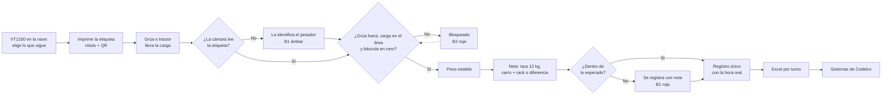

# Codelco-Proyecto
Proyecto de codelco sobre camaras y pesaje

Propuesta de Ingmétrica para la **Báscula N9 de la Refinería Ventanas** (Codelco División Ventanas): identificar y pesar las cargas de cátodos comerciales, láminas y restos de ánodos. La etiqueta se imprime en la nave, la báscula controla el peso y todo queda en un solo registro, listo en Excel.

## Contenido

| Archivo | Qué es |
|---|---|
| `simulacion-bascula.html` | Simulación de la báscula: escena, cámara, balizas B1 y B2, pantalla del pesador y los sistemas actuales. Usa `estilos.css`, `casos.js`, `sim.js`, `iso.js` y `prueba.js` (tienen que estar en la misma carpeta). |
| `terminal-vt1200.html` | Maqueta de la pantalla de la VT1200 en la nave (1024 × 768): imprime la etiqueta de cada carga, muestra la Báscula N9 en vivo controlando el peso, guarda el registro y baja el Excel. |
| `diagramas/flujo-bascula-n9.svg` | Diagrama del flujo propuesto (también en `.png`). Se genera con `diagramas/generar_diagrama.py`. |
| `presentacion/Bascula-N9-Ventanas.pptx` | Presentación de 15 láminas con los datos de la visita, las pantallas y los flujos. |
| `presentacion/fuente/` | Lo que arma la presentación: `generar.js` (pptxgenjs), `capturas.py` (saca las capturas) e `img/`. |

## Cómo verlo

Los dos HTML se abren directo en el navegador, sin instalar nada. Necesitan internet solo para las fuentes (Google Fonts) y las librerías (cdnjs: código QR y Excel).

- **Simulación:** elija un producto (cátodos, restos, láminas, dos pallets montados) o una situación (sin etiqueta, grúa encima, carro fuera del área, nódulos, fuera de orden, fuera de rango, lado parcial).
- **Maqueta VT1200:** toque Entrar e Imprimir. La báscula de la derecha pesa cada carga. En la guía de la derecha están los botones para probar grúa encima, carro fuera del área y báscula sin cero. El botón Excel baja el registro del día.

## Flujo propuesto


La misma idea en texto, para editarla rápido:



## Regenerar la presentación y el diagrama

```
cd presentacion/fuente
corepack pnpm install        # con pnpm, no con npm
python capturas.py           # opcional: vuelve a sacar las capturas (Playwright + Brave)
node generar.js              # escribe presentacion/Bascula-N9-Ventanas.pptx

python diagramas/generar_diagrama.py   # desde la raíz: vuelve a escribir el SVG del flujo
```

`generar.js` revisa que los totales cuadren con el Resumen del Sistema de Cátodos (lado T 100.089 kg, lado P 64.309 kg, total 165.252 kg) antes de armar el archivo.

## Datos

- Pesos de cátodos y restos del 22-10-2026, grupo 21, y la hoja de láminas del 21-10, tomados en la visita.
- Las taras de carro + rack son de ejemplo, hasta tener la lista real.
- La maqueta simula la báscula y la impresora: no se conecta a ningún equipo.
